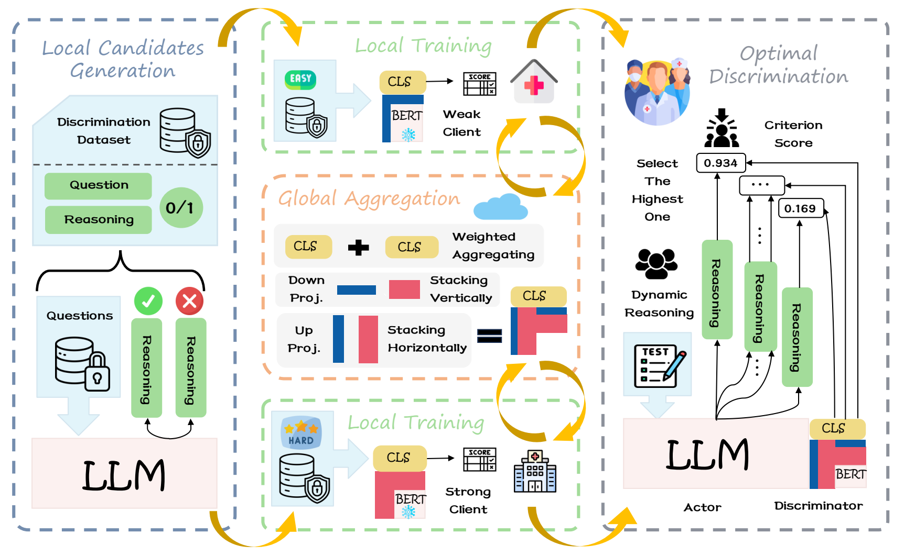

<div align="center">

# FedCoT

### Communication-Efficient Federated Reasoning Enhancement for Large Language Models

Chuan Li · Qianyi Zhao · Fengran Mo · Cen Chen

East China Normal University · University of Montreal


[](https://arxiv.org/abs/2508.10020)

[Overview](#overview) · [Results](#results) · [Getting Started](#getting-started) · [Citation](#citation)

</div>

## Overview

**FedCoT improves medical reasoning by federating a lightweight reasoning discriminator.** Each client generates multiple chain-of-thought candidates locally. A collaboratively trained discriminator then selects the most promising response, while the actor LLM's weights remain fixed.

<p align="center">
  
</p>
<p align="center"><em>Local candidate generation, federated discriminator learning, and inference-time reasoning selection.</em></p>

- **Learn from informative candidates:** retain questions with both correct and incorrect responses, and balance the training candidates.
- **Score reasoning with soft supervision:** combine answer correctness with an NLI entailment score to train the discriminator.
- **Support heterogeneous clients:** stack LoRA modules with different ranks and aggregate classifier heads using client weights.
- **Keep communication compact:** exchange discriminator updates; raw training examples stay on their clients.

## Results

### Medical QA accuracy

Each value is average accuracy (%) across BioASQ, MedMCQA, MedQA, medical MMLU, and PubMedQA.

| Method | LLaMA-3-8B-Instruct | Qwen2.5-7B-Instruct |
|:--|--:|--:|
| CoT prompting | 28.56 | 47.14 |
| Self-consistency | 28.08 | 51.66 |
| FedIT | 45.63 | 58.19 |
| FedFFA-LoRA | 32.90 | 60.54 |
| FLoRA | 38.73 | 62.41 |
| FedPrompt | 46.10 | 55.22 |
| **FedCoT** | **55.50** | **68.70** |

FedCoT improves average accuracy by **26.94** and **21.56 percentage points** over CoT prompting on the two actor models, respectively.

## Getting Started

Run the commands below from the repository root on Linux with NVIDIA GPUs, Bash, GNU Make, and Conda.

### 1. Environment and data

<details>
<summary><strong>Install the environment and prepare data access</strong></summary>

```bash
conda env create -f environment.yml
conda activate fedcot
```

MedMCQA, MedQA, MMLU, and PubMedQA are loaded through Hugging Face. For BioASQ, place the official golden files under `data/bioasq/Task{year}BGoldenEnriched/`, following the paths in [dataset_loader.py](src/dataset_loader.py).

The default discriminator is `allenai/longformer-base-4096`; soft-label preparation uses `cross-encoder/nli-deberta-v3-base`.

</details>

### 2. Generate reasoning candidates

<details>
<summary><strong>Generate eight candidates per question for training and evaluation</strong></summary>

```bash
make -f recipes/gen_cot.makefile generate \
  MODEL_PATH=/path/to/local/Meta-Llama-3-8B-Instruct \
  DATASETS=bioasq,medmcqa,medqa,mmlu,pubmedqa \
  NUM_CANDIDATES=8
```

Outputs are saved under `outputs/best_of_n/<model-directory-name>/`, with separate dataset, split, and version directories. Use the same model directory name in the next step.

</details>

### 3. Train and evaluate FedCoT

<details>
<summary><strong>Run candidate preparation, federated training, and evaluation</strong></summary>

```bash
make -f recipes/fedcot.makefile full_pipeline \
  model_name=Meta-Llama-3-8B-Instruct \
  reward_model=allenai/longformer-base-4096
```

The pipeline filters training candidates, assigns NLI-based soft rewards, trains the federated discriminator, and evaluates its candidate selection. The default recipe uses five clients, three global rounds, one local epoch per round, and heterogeneous LoRA ranks `4,32,32,16,4`.

To prepare the discriminator's training data separately:

```bash
make -f recipes/fedcot.makefile prepare_data \
  model_name=Meta-Llama-3-8B-Instruct
```

By default, the recipes use the latest generated version. Set `dataset_versions` and `eval_dataset_versions` to select explicit versions. See [fedcot.makefile](recipes/fedcot.makefile) for training and evaluation options.

</details>

## Code Guide

| Path | Role |
|:--|:--|
| `src/best_of_n_generator.py` | Local chain-of-thought candidate generation |
| `src/data_preparation.py` | Candidate filtering and NLI-based soft labels |
| `src/reward_model.py` | Lightweight reasoning discriminator |
| `src/federated_reward_model.py` | Client training, LoRA stacking, and classifier aggregation |
| `src/evaluation.py` | Discriminator-based candidate selection and scoring |
| `src/fed_pipeline.py` | End-to-end preparation, training, and evaluation |
| `recipes/` · `configs/` | Reproducible run recipes and generation settings |

## Citation

```bibtex
@misc{li2025fedcot,
  title = {FedCoT: Communication-Efficient Federated Reasoning Enhancement for Large Language Models},
  author = {Chuan Li and Qianyi Zhao and Fengran Mo and Cen Chen},
  year = {2025},
  eprint = {2508.10020},
  archivePrefix = {arXiv},
  primaryClass = {cs.CL},
  url = {https://arxiv.org/abs/2508.10020}
}
```
